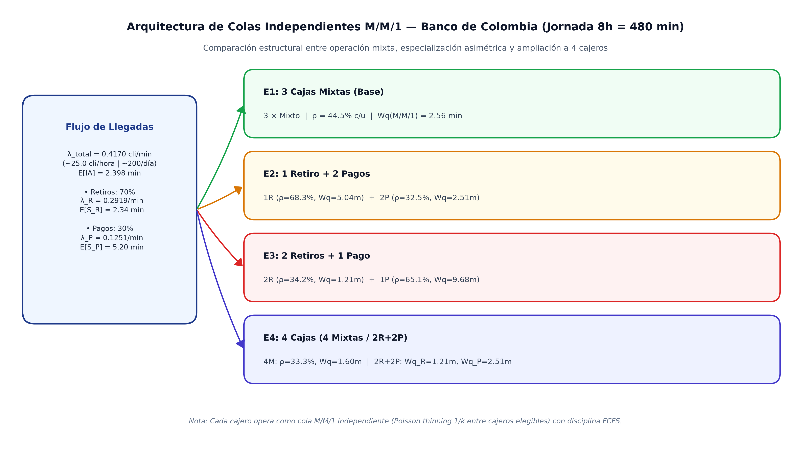
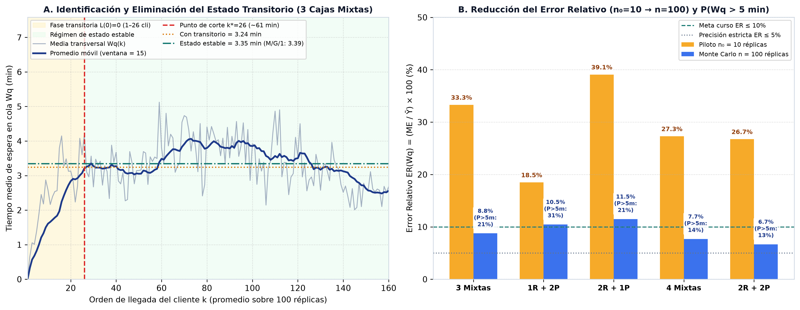
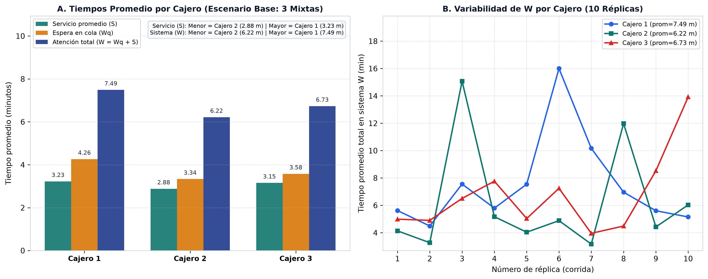
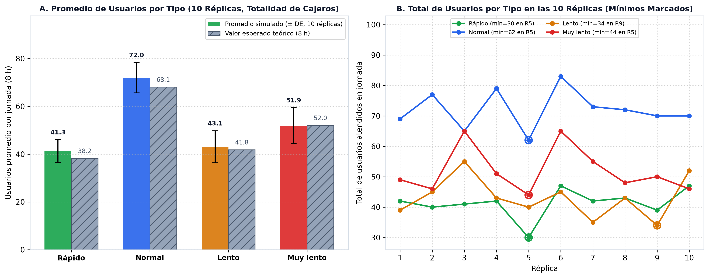
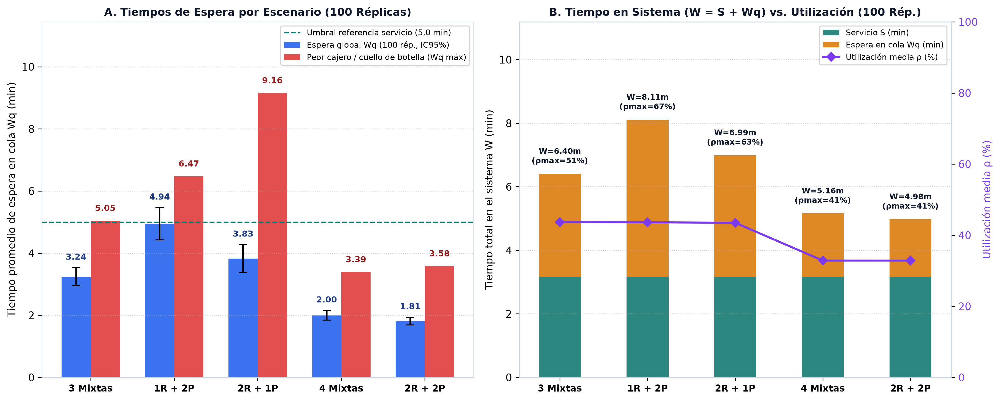
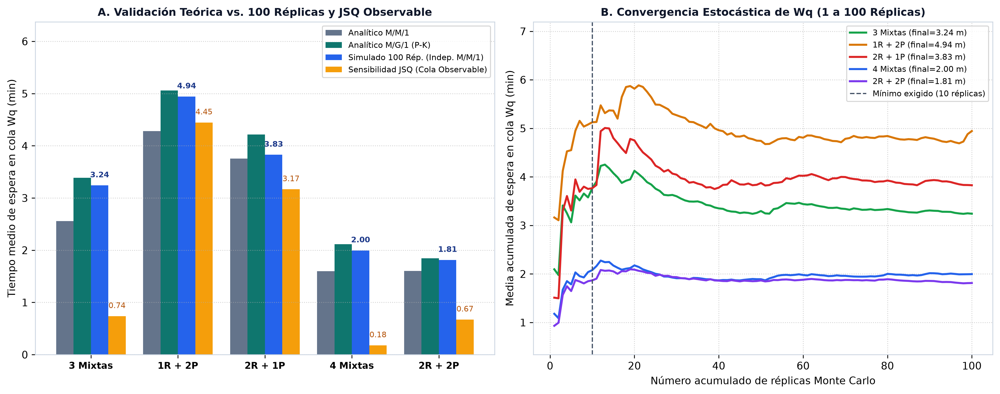
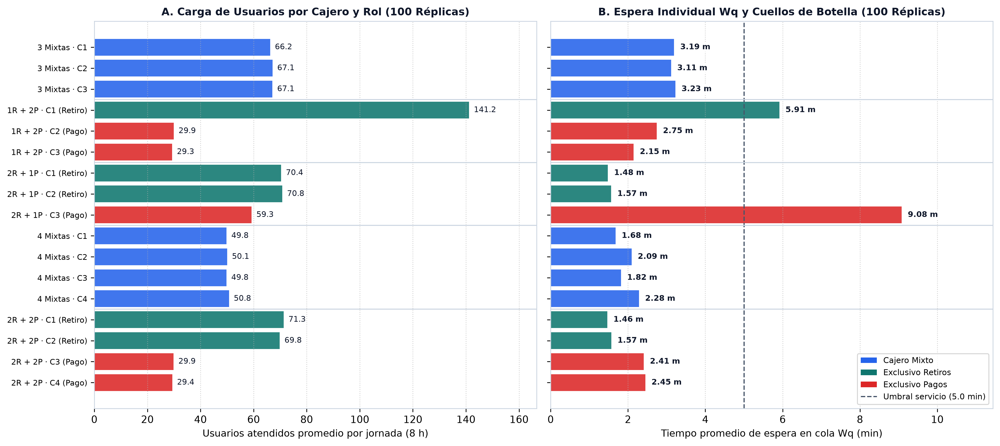

# Simulación de Colas Independientes M/M/1 — Solución del Problema Bancario (Banco de Colombia)

[](https://colab.research.google.com/github/Camilo-Alberto-Palacio/Simulacion-Colas-Banco-MM1/blob/main/Simulacion_Colas_Banco_Colab.ipynb)


Modelado matemático, simulación de eventos discretos (DES) y optimización operativa de cajeros independientes **$M/M/1$** para el **Banco de Colombia** durante jornadas diarias de **8 horas ($480\text{ minutos}$)**.

Proyecto desarrollado para la **Actividad Didáctica 2-M3 — Módulo 2** de la asignatura **Simulación (`PREICA2602B020045`)** en la **Institución Universitaria Digital de Antioquia (IU Digital)**.

---

## Tabla de Contenidos
1. [Descripción del Problema y Parámetros Oficiales](#descripción-del-problema-y-parámetros-oficiales)
2. [Formulación Teórica M/M/1 y M/G/1](#formulación-teórica-mm1-y-mg1)
3. [Estructura del Repositorio](#estructura-del-repositorio)
4. [Instalación e Instrucciones de Ejecución](#instalación-e-instrucciones-de-ejecución)
5. [Resultados Principales (10 y 100 Réplicas)](#resultados-principales-10-y-100-réplicas)
6. [Visualizaciones Científicas (300 DPI)](#visualizaciones-científicas-300-dpi)
7. [Equipo de Trabajo (Grupo 25)](#equipo-de-trabajo-grupo-25)
8. [Licencia](#licencia)

---

## Descripción del Problema y Parámetros Oficiales

El **Banco de Colombia** dispone de **3 cajas** (sin cajeros electrónicos) para atender **Retiros (70 %)** y **Consignaciones o pagos (30 %)** durante **8 horas/día (`480 min`)**, modelando cada caja como un sistema **$M/M/1$ independiente** bajo disciplina FCFS y desplazamiento despreciable.

| Acción (Proporción) | Tipo de Usuario | Probabilidad Condicional | Prob. Conjunta | Media de Servicio ($E[S]$) | Media de Llegada ($E[IA]$) |
| :--- | :--- | :---: | :---: | :---: | :---: |
| **Retiro (70 %)** | Rápido | `0.23` | `16.1 %` | `1.0 min` | `1.0 min` |
| **Retiro (70 %)** | Normal | `0.40` | `28.0 %` | `2.0 min` | `2.0 min` |
| **Retiro (70 %)** | Lento | `0.17` | `11.9 %` | `3.0 min` | `3.0 min` |
| **Retiro (70 %)** | Muy lento | `0.20` | `14.0 %` | `4.0 min` | `3.0 min` |
| **Consignación / Pago (30 %)** | Rápido | `0.10` | `3.0 %` | `3.0 min` | `1.0 min` |
| **Consignación / Pago (30 %)** | Normal | `0.20` | `6.0 %` | `3.0 min` | `2.0 min` |
| **Consignación / Pago (30 %)** | Lento | `0.30` | `9.0 %` | `5.0 min` | `3.0 min` |
| **Consignación / Pago (30 %)** | Muy lento | `0.40` | `12.0 %` | `7.0 min` | `4.0 min` |

---

## Formulación Teórica M/M/1 y M/G/1

* **Tiempo medio entre llegadas global:** $\mathbb{E}[IA] = 2.398\text{ min} \implies \lambda_{\text{total}} = 0.4170\text{ cli/min}$ ($\approx 200.2\text{ usuarios/8h}$).
* **Tiempos medios de servicio:** $\mathbb{E}[S_{\text{Retiro}}] = 2.34\text{ min}$, $\mathbb{E}[S_{\text{Pago}}] = 5.20\text{ min}$, $\mathbb{E}[S_{\text{Mixto}}] = 3.198\text{ min}$.
* **Leyes de Little y estabilidad ($\rho = \lambda_c / \mu_c < 1$):**
  $$L_q = \frac{\rho^2}{1-\rho}, \qquad W_q^{\text{M/M/1}} = \frac{\rho}{\mu_c(1-\rho)}, \qquad W = W_q + \frac{1}{\mu_c}, \qquad W_q^{\text{M/G/1}} = \frac{\lambda_c \mathbb{E}[S^2]}{2(1-\rho)}$$



---

## Estructura del Repositorio

```text
.
├── bank_queue/                                       # Paquete modular principal en Python
│   ├── __init__.py                                   # Exportación pública
│   ├── model.py                                      # Tablas 1 y 2, analítica M/M/1-M/G/1, P(Wq>5m) y regímenes ρ
│   ├── simulation.py                                 # Motor DES (10R, n*, ER%, warm-up, V&V, 100R Monte Carlo y JSQ)
│   └── visualizations.py                             # Generador de 7 figuras científicas a 300 DPI
├── tests/
│   ├── __init__.py
│   └── test_bank_queue.py                            # 14 pruebas unitarias (Momentos, Little, t-Student, ER%, warm-up, V&V)
├── results/                                          # CSVs auditables y 7 figuras PNG (300 DPI)
├── main.py                                           # Script maestro experimental
├── create_colab_notebook.py                          # Generador y ejecutor del cuaderno Colab
├── Simulacion_Colas_Banco_Colab.ipynb                # Cuaderno Colab autocontenido y pre-ejecutado
├── generate_doc.py                                   # Generador dinámico APA 7 del informe Word (.docx)
├── Evidencia de Aprendizaje 3 - Módulo 2. Actividad didáctica 2-M3 - Solución Problema Bancario.docx
├── GUION_VIDEO_SUSTENTACION.md                       # Guion minuto a minuto (2:30 min)
├── requirements.txt
├── LICENSE
└── README.md
```

---

## Instalación e Instrucciones de Ejecución

### Opción A: Ejecución en la Nube (Google Colab)
Haz clic en el botón **Open in Colab** al inicio de este documento y ejecuta `Entorno de ejecución -> Ejecutar todas`.

### Opción B: Ejecución Local en Terminal
```bash
# 1. Instalar dependencias
pip install -r requirements.txt

# 2. Ejecutar las 14 pruebas unitarias de validación matemática y V&V
python -m unittest discover -s tests -v

# 3. Ejecutar la simulación completa (10R + 100 Monte Carlo + Warm-up + V&V + 7 figuras)
python main.py

# 4. Regenerar informe Word (.docx) y cuaderno Google Colab pre-ejecutado
python generate_doc.py
python create_colab_notebook.py
```

---

## Resultados Principales (10 y 100 Réplicas)

### 1. Puntos 1–3 (10 Réplicas Oficiales, Escenario Base: 3 Cajas Mixtas)
* **Punto 1 — Cajero con menor y mayor atención:**
  * **Menor tiempo promedio:** `Cajero 2` ($S = 2.882\text{ min}$, $W_q = 3.335\text{ min}$, $W = 6.217\text{ min}$, $\rho = 40.4\%$).
  * **Mayor tiempo promedio:** `Cajero 1` ($S = 3.226\text{ min}$, $W_q = 4.263\text{ min}$, $W = 7.490\text{ min}$, $\rho = 47.5\%$).
* **Punto 2 — Promedio diario de usuarios por tipo (`208.30` usuarios/día totales):**
  * Sucursal total: `Rápido`: **`41.30 ± 4.76`** · `Normal`: **`72.00 ± 6.34`** · `Lento`: **`43.10 ± 6.69`** · `Muy lento`: **`51.90 ± 7.55`** (`13.77 / 24.00 / 14.37 / 17.30` promedio por cajero).
* **Punto 3 y Suficiencia Muestral ($n^*$):**
  * Mínimos entre las 10 réplicas: `Rápido = 30` (R5), `Normal = 62` (R5), `Lento = 34` (R9), `Muy lento = 44` (R5).
  * Menor carga individual por servidor: `Cajero 3 (Pago)` en `1R + 2P` (`28.8` usuarios/día: `3.0` Rápido, `6.2` Normal, `8.5` Lento, `11.1` Muy lento).
  * Réplicas necesarias ($n^*$, 95 % *t* de Student para $\varepsilon = \pm 0.50\text{ min}$ en $W_q$): `10` (`2R+2P`), `13` (`4 Mixtas`), `30` (`1R+2P`), `50` (`3 Mixtas`) y `68` (`2R+1P`); `51` réplicas para demanda diaria ($\pm 5\text{ usr/día}$). Las `100` réplicas Monte Carlo superan todos los criterios.

### 2. Puntos 4–5 (Comparativa de Escenarios y Criterios — 100 Réplicas Monte Carlo)

| Escenario | Espera Global $W_q$ (IC95% *t*) | $W_q$ Retiro / Pago | Peor Cajero $W_q$ | Sistema $W$ | $W_q$ JSQ (Cola observable) | Uso Medio $\bar{\rho}$ / Máx |
| :--- | :---: | :---: | :---: | :---: | :---: | :---: |
| **E1: 3 Mixtas (Óptimo 3 cajas)** | **`3.24 min`** `[2.96–3.53]` | `3.29 / 3.15 m` | **`5.05 min`** | `6.40 min` | **`0.74 min`** | `43.7%` / `50.9%` |
| **E2: 1 Retiro + 2 Pagos** | `4.94 min` `[4.43–5.46]` | `5.91 / 2.49 m` | `6.47 min` | `8.11 min` | `4.45 min` | `43.6%` / `67.4%` |
| **E3: 2 Retiros + 1 Pago** | `3.83 min` `[3.39–4.27]` | `1.54 / 9.08 m` | **`9.16 min`** | `6.99 min` | `3.17 min` | `43.5%` / `62.7%` |
| **E4A: 4 Mixtas (Nuevo cajero)** | `2.00 min` `[1.84–2.15]` | `2.07 / 1.84 m` | `3.39 min` | `5.16 min` | `0.18 min` | `32.9%` / `41.0%` |
| **E4B: 2 Retiros + 2 Pagos** | `1.81 min` `[1.69–1.93]` | `1.53 / 2.47 m` | `3.58 min` | `4.98 min` | `0.67 min` | `32.9%` / `40.5%` |

* **Decisión sobre nuevo cajero físico o electrónico (Punto 4):** **No es necesario** incorporar un 4.º cajero ni un cajero electrónico manteniendo **3 cajas mixtas** (`3.24 min` global, `3.29 m` retiros, `3.15 m` pagos y `56.3%` de capacidad libre; un 4.º cajero hunde la ocupación a `32.9%`).
* **Decisión sobre cajas exclusivas (Punto 5):** Conservar **3 cajas mixtas (`0` exclusivas de retiro / `0` exclusivas de pago)**. Si se obligara a especializar con 3 cajas, `2R + 1P` dispara la espera media de pagos a `9.08 min` (peor réplica `9.16 min`, sistema `14.25 min`), mientras `1R + 2P` sobrecarga retiros (`5.91 min`) y eleva la espera global a `4.94 min`.

### 3. Validación Semana 7 / Clase AAA: Error Relativo ($ER\%$), Estado Estable y Valores Críticos
* **Algoritmo de 8 pasos ($ER\%$):** Con $n_0=10$, el error relativo sobre $W_q$ es `33.3%` en `3 Mixtas` (`n_prof = 111` para $ER \le 10\%$). Con `100` réplicas Monte Carlo, `3 Mixtas` reduce su error a **`8.8%`** en $W_q$ y **`5.03%`** en $W$.
* **Eliminación del período transitorio (*warm-up*):** Al arrancar el banco vacío ($L(0)=0$), la media móvil (ventana `15`) detecta estabilización tras $k^* = 26$ clientes (`~61 min` en `3 Mixtas`). Descartando el transitorio, $W_q^{\text{estable}} = 3.35\text{ min}$ (vs. `3.24 min` con transitorio, sesgo `-3.1%`), coincidiendo con Pollaczek–Khinchine $M/G/1$ (`3.39 min`, prueba *t* bilateral $p = 0.773 > 0.05$).
* **Matriz V&V y Valores Críticos:** Verificación de Ley de Little (`< 10^{-10}`), calibración de perfiles (`MAE = 0.19` p.p.) y probabilidad de espera prolongada $P(W_q > 5\text{ min})$ de **`20.9%`** global en `3 Mixtas`, frente a **`37.7%`** en retiros de `1R+2P` y **`43.6%`** en pagos de `2R+1P`.



---

## Visualizaciones Científicas (300 DPI)

| Punto 1: Desempeño por Cajero | Puntos 2 y 3: Usuarios por Tipo y Réplicas |
| :---: | :---: |
|  |  |
| **Puntos 4 y 5: Comparativa de Escenarios** | **Validación Teórica M/M/1–M/G/1 y Monte Carlo** |
|  |  |



---

## Equipo de Trabajo (Grupo 25)

* **Adriana Andrea Agudelo Agudelo**
* **Camilo Alberto Palacios Turriago**
* **Juan Daniel Pulgarin García**
* **Ruben Dario Jaramillo Cervantes**

**Docente:** Dr. Julián Andrés Loaiza López  
**Asignatura:** Simulación — `PREICA2602B020045`  
**Institución:** Institución Universitaria Digital de Antioquia (IU Digital) — Facultad de Ingeniería  
**Sede y Fecha:** Medellín, Antioquia · Noviembre de 2026

---

## Licencia

Distribuido bajo la licencia **MIT**. Consulta el archivo [`LICENSE`](LICENSE) para más detalles.
